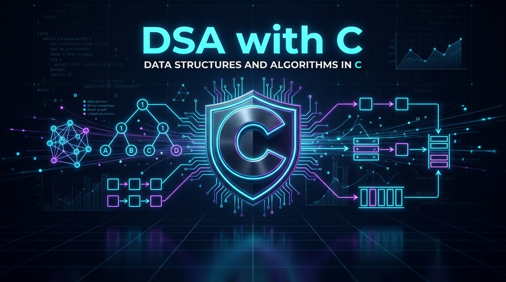

<!-- markdownlint-disable MD033 MD041 MD023 -->
<div align="center">

  

  # Data Structures & Algorithms with C 🚀
  
  **A structured, hands-on, bare-metal journey to mastering Data Structures and Algorithms from scratch using pure C.**

  [](https://en.wikipedia.org/wiki/C_(programming_language))
  [](https://gcc.gnu.org/)
  [](https://github.com/)
  [](https://github.com/Sachinxcode-01/DSA-with-C)
  [](LICENSE)

</div>
<!-- markdownlint-enable MD033 MD041 MD023 -->

---

## 📌 Table of Contents

- [Overview](#-overview)
- [Why Learn DSA in C?](#-why-learn-dsa-in-c)
- [Repository Architecture](#-repository-architecture)
- [Curriculum & Learning Roadmap](#-curriculum--learning-roadmap)
- [Solved Problems Directory](#-solved-problems-directory)
- [Getting Started & Compilation](#-getting-started--compilation)
- [Debugging with VS Code](#-debugging-with-vs-code)
- [Coding Guidelines & Standards](#-coding-guidelines--standards)
- [Contributing](#-contributing)
- [License](#-license)

---

## 🎯 Overview

Welcome to **DSA with C**! This repository is a meticulously curated repository designed to build mastery over foundational computer science concepts. It covers everything from low-level C programming constructs—data types, memory addressing, pointers, and control structures—to production-grade data structures and algorithmic paradigms.

Every implementation emphasizes:

- **Bare-metal clarity:** Understanding memory allocation (`malloc`, `calloc`, `free`) and pointers directly without language abstractions.
- **Robustness:** Proper bounds checking, edge-case validation, and input sanitization.
- **Algorithmic efficiency:** Rigorous time and space complexity evaluations ($O(n)$, $O(\log n)$, $O(1)$).

---

## 💡 Why Learn DSA in C?

Unlike higher-level languages that abstract memory management behind automatic garbage collection, learning DSA in **C** provides invaluable advantages:

1. **Direct Memory Access:** You control the heap and stack directly, giving intuitive insight into cache locality, pointer indirection, and memory leaks.
2. **True Performance Awareness:** Understand the actual clock-cycle cost and space overhead of pointers, nodes, dynamic arrays, and recursion frames.
3. **Universal Foundation:** Concepts mastered here seamlessly translate to Systems Programming, Operating Systems, Embedded Systems, C++, Rust, and Computer Architecture.

---

## 🧭 Curriculum & Learning Roadmap

| # | Module | Core Concepts | Status |
| :---: | :--- | :--- | :---: |
| **01** | **[01-C-Basics](./01-C-Basics/)** | Syntax, Data Types, Operators, Conditionals, Loops, Jump Statements | 🟢 Complete |
| **02** | **[Practice & Problems](./problems/)** | Level-01 (Basics & Logic) & Level-02 (Loops, Patterns, Factorials) | 🟢 28+ Solved |
| **03** | **[02-Control-Flow](./02-Control-Flow/)** | Advanced Decision Making, State Machines, Nested Evaluations | 🟡 In Progress |
| **04** | **[03-Functions-Scope](./03-Functions-Scope/)** | Call by Value vs Reference, Recursion Foundations, Storage Classes | 🟡 In Progress |
| **05** | **[04-Arrays-Strings](./04-Arrays-Strings/)** | 1D/2D Matrix Operations, String Manipulation, Pointer Decays | ⚪ Scheduled |
| **06** | **[05-Pointers-Memory](./05-Pointers-Memory/)** | Pointer Arithmetic, Double Pointers, Heap Allocation (`malloc`/`free`) | ⚪ Scheduled |
| **07** | **[06-Structures-Unions](./06-Structures-Unions/)** | Padding, Alignment, Self-Referential Structs, Type Definitions | ⚪ Scheduled |
| **08** | **[07-Linked-Lists](./07-Linked-Lists/)** | Singly, Doubly, Circular Linked Lists, Fast & Slow Pointers | ⚪ Scheduled |
| **09** | **[08-Stacks-Queues](./08-Stacks-Queues/)** | LIFO/FIFO, Ring Buffers, Monotonic Stacks, Expression Parsing | ⚪ Scheduled |
| **10** | **[09-Trees](./09-Trees/)** | Binary Trees, Binary Search Trees (BST), AVL Trees, Tree Traversals | ⚪ Scheduled |
| **11** | **[10-Heaps-Priority-Queues](./10-Heaps-Priority-Queues/)** | Min-Heap, Max-Heap, Heapify, Heap Sort | ⚪ Scheduled |
| **12** | **[11-Hashing](./11-Hashing/)** | Hash Functions, Collision Resolution (Chaining, Open Addressing) | ⚪ Scheduled |
| **13** | **[12-Graphs](./12-Graphs/)** | Adjacency Matrix & Lists, BFS, DFS, Dijkstra, MST (Prim/Kruskal) | ⚪ Scheduled |
| **14** | **[13-Searching-Sorting](./13-Searching-Sorting/)** | Binary Search, Quick Sort, Merge Sort, Linear Sorts | ⚪ Scheduled |
| **15** | **[14-Recursion-Backtracking](./14-Recursion-Backtracking/)** | Divide & Conquer, Subsets, Permutations, N-Queens | ⚪ Scheduled |
| **16** | **[15-Dynamic-Programming](./15-Dynamic-Programming/)** | Memoization, Tabulation, 0/1 Knapsack, LCS, LIS | ⚪ Scheduled |
| **17** | **[16-Greedy-Algorithms](./16-Greedy-Algorithms/)** | Activity Selection, Fractional Knapsack, Huffman Coding | ⚪ Scheduled |

---

## 📂 Repository Architecture

```plaintext
DSAwithC/
├── assets/
│   └── banner.png                     # Repository banner graphic
├── 01-C-Basics/                       # Fundamental C language constructs
│   ├── hello.c                        # Standard output & structure
│   ├── data_types.c                   # Primitive types, memory sizes & specifiers
│   ├── variables.c                    # Variables initialization & scopes
│   ├── variable_calculation.c         # Arithmetic expressions
│   ├── arithmetic_operators.c         # Operators (+, -, *, /, %)
│   ├── assignment_operators.c         # Compound assignments (+=, -=, etc.)
│   ├── increment_decrement.c          # Pre/Post increment & decrement nuances
│   ├── relational_operators.c         # Comparison operations (<, >, ==, !=)
│   ├── logical_operators.c            # Boolean logic (&&, ||, !)
│   ├── if_statement.c                 # Single decision branching
│   ├── if_else.c                      # Two-way conditional logic
│   ├── else_if.c                      # Multi-way ladder branching
│   ├── nested_if.c                    # Nested conditional structures
│   ├── switch_statement.c             # Multi-branch menu selection
│   ├── for_loop.c                     # Counter-controlled iterations
│   ├── while_loop.c                   # Pre-test condition iterations
│   ├── do_while_loop.c                # Post-test condition iterations
│   ├── nested_loops.c                 # 2D coordinate loop patterns
│   ├── break_statement.c              # Loop termination control
│   └── continue_statement.c           # Skipping iteration control
│
├── practice/                          # Core concept practice modules
│   ├── 13_else_if_practice.c          # Real-world else-if validation
│   ├── 14_nested_if_practice.c        # Eligibility qualification engine
│   ├── 15_switch_practice.c           # Menu-driven state transitions
│   ├── 16_for_loop_practice.c         # Accumulator loops
│   ├── 17_while_loop_practice.c       # Controlled stepping loops
│   ├── 18_do_while_practice.c         # Interactive loop processing
│   ├── 19_nested_loops_practice.c     # Coordinate matrix generation
│   └── 19_nested_pattern_practice.c   # Right-angle star patterns
│
├── practice-problems/
│   └── while_even_numbers.c           # Iterative even number extraction
│
├── problems/                          # Graded Problem Solving Sets
│   ├── README.md                      # Problem tiers and category index
│   ├── Level-01/                      # Foundations: I/O, Math & Conditionals
│   │   ├── 01_personal_info.c         # Formatted data representation
│   │   ├── 02_basic_calculator.c      # Safe arithmetic engine with zero-check
│   │   ├── 03_rectangle_area.c        # Geometric computation
│   │   ├── 04_even_odd.c              # Parity testing using modulus
│   │   ├── 05_positive_negative_zero.c# Number classification
│   │   ├── 06_largest_two.c           # Maximum comparison
│   │   ├── 07_grade_calculator.c      # Score tier classification
│   │   ├── 08_switch_calculator.c     # Clean arithmetic dispatcher
│   │   ├── 09_print_numbers.c         # Range generation
│   │   └── 10_sum_natural_numbers.c   # Series summation formula & loop
│   │
│   └── Level-02/                      # Intermediate: Iteration, Math & Patterns
│       ├── 11_even_numbers.c          # Even number filter (1 to 100)
│       ├── 12_odd_numbers.c           # Step-increment odd series
│       ├── 13_multiplication_table.c  # Multiplication table generator
│       ├── 14_factorial.c             # 64-bit factorial computation
│       ├── 15_reverse_counting.c      # Decrement countdown
│       ├── 16_while_counting.c        # While-loop sequence generator
│       ├── 17_input_until_zero.c      # Sentinel-controlled input loop
│       ├── 18_square_pattern.c        # 5x5 Square star matrix
│       ├── 19_triangle_pattern.c      # Dynamic right-angled triangle
│       ├── 20_tables_pattern.c        # Nested multiplication table (1 to 5)
│       ├── 22_continue_practice.c     # Odd number filter using continue
│       ├── 23_welcome_function.c      # Basic function prototype and calls
│       ├── 24_function_parameters_practice.c # Function with parameters
│       ├── 25_calculator_function.c   # Multi-operation calculator function
│       └── 26_calculator_return.c     # Calculation using returned values
│
├── 03-Functions-Scope/                # Modular programming & variable scope
│   ├── function_intro.c               # Function declaration, call & definition
│   ├── function_parameters.c          # Formal parameters & argument passing
│   └── function_return.c              # Returning values from functions
│
├── .vscode/                           # Pre-configured debug & build setup
│   ├── launch.json                    # GDB debugger configuration
│   └── tasks.json                     # GCC build automation tasks
└── README.md                          # Repository documentation
```

---

## 🧩 Solved Problems Directory

### 🟢 Level-01: Foundations & Control Flow

| # | Problem File | Concept Covered | Input / Output Highlights |
| :---: | :--- | :--- | :--- |
| **01** | [`01_personal_info.c`](./problems/Level-01/01_personal_info.c) | Format Specifiers (`%s`, `%d`, `%.1f`, `%c`) | Structured profile output |
| **02** | [`02_basic_calculator.c`](./problems/Level-01/02_basic_calculator.c) | Arithmetic operators & zero-division check | Addition, Subtraction, Product, Quotient |
| **03** | [`03_rectangle_area.c`](./problems/Level-01/03_rectangle_area.c) | Input handling & formula computation | Area calculation from user inputs |
| **04** | [`04_even_odd.c`](./problems/Level-01/04_even_odd.c) | Modulo operator (`% 2`) | Parity validation |
| **05** | [`05_positive_negative_zero.c`](./problems/Level-01/05_positive_negative_zero.c) | Multi-branch conditionals | Sign classification |
| **06** | [`06_largest_two.c`](./problems/Level-01/06_largest_two.c) | Relational operators | Comparison of two inputs |
| **07** | [`07_grade_calculator.c`](./problems/Level-01/07_grade_calculator.c) | Range validation & grade boundary logic | Academic grade scale (A, B, C, D, Fail) |
| **08** | [`08_switch_calculator.c`](./problems/Level-01/08_switch_calculator.c) | Switch-case dispatch & buffer management | Full interactive 4-function calculator |
| **09** | [`09_print_numbers.c`](./problems/Level-01/09_print_numbers.c) | Bounded for-loop | Serial numbers 1 to 10 |
| **10** | [`10_sum_natural_numbers.c`](./problems/Level-01/10_sum_natural_numbers.c) | Accumulator variable pattern | Series sum $\sum_{i=1}^n i$ |

### 🔵 Level-02: Loops, Math & 2D Patterns

| # | Problem File | Concept Covered | Input / Output Highlights |
| :---: | :--- | :--- | :--- |
| **11** | [`11_even_numbers.c`](./problems/Level-02/11_even_numbers.c) | Modulus filter inside loop | All even numbers in range [1, 100] |
| **12** | [`12_odd_numbers.c`](./problems/Level-02/12_odd_numbers.c) | Step-stride iteration (`i += 2`) | Odd numbers up to 50 |
| **13** | [`13_multiplication_table.c`](./problems/Level-02/13_multiplication_table.c) | Formatted string output & dynamic ranges | Full 10-line multiplication table |
| **14** | [`14_factorial.c`](./problems/Level-02/14_factorial.c) | 64-bit integer type (`long long`) | Large factorial computation ($N!$) |
| **15** | [`15_reverse_counting.c`](./problems/Level-02/15_reverse_counting.c) | Loop decrement operator (`i--`) | Reverse countdown 10 to 1 |
| **16** | [`16_while_counting.c`](./problems/Level-02/16_while_counting.c) | While loop lifecycle | Sequential execution 1 to 10 |
| **17** | [`17_input_until_zero.c`](./problems/Level-02/17_input_until_zero.c) | Sentinel-controlled termination | Continuous reading until `0` entered |
| **18** | [`18_square_pattern.c`](./problems/Level-02/18_square_pattern.c) | 2D nested loops | $5 \times 5$ square star grid |
| **19** | [`19_triangle_pattern.c`](./problems/Level-02/19_triangle_pattern.c) | Dependent nested loops (`j <= i`) | Right-angled star triangle |
| **20** | [`20_tables_pattern.c`](./problems/Level-02/20_tables_pattern.c) | Dual-level nested loops | Complete tables for numbers 1 through 5 |
| **21** | [`22_continue_practice.c`](./problems/Level-02/22_continue_practice.c) | Skip iteration (`continue`) | Filter and display odd numbers (0 to 10) |
| **22** | [`23_welcome_function.c`](./problems/Level-02/23_welcome_function.c) | Modular functions | Function declaration, call & definition |
| **23** | [`24_function_parameters_practice.c`](./problems/Level-02/24_function_parameters_practice.c) | Function parameters | Passing integer arguments to functions |
| **24** | [`25_calculator_function.c`](./problems/Level-02/25_calculator_function.c) | Multi-parameter functions | Safe arithmetic calculator function |
| **25** | [`26_calculator_return.c`](./problems/Level-02/26_calculator_return.c) | Value-returning functions | Arithmetic functions returning calculation results |

---

## ⚙️ Getting Started & Compilation

### Prerequisites

Ensure you have a modern C compiler supporting **C99/C11**:

- **Windows:** [MinGW-w64 (via MSYS2)](https://www.msys2.org/) or [w64devkit](https://github.com/skeeto/w64devkit)
- **Linux:** `gcc` via `build-essential` (`sudo apt install build-essential`)
- **macOS:** Apple Clang / GCC (`xcode-select --install`)

Verify installation:

```bash
gcc --version
```

### Compiling and Running

Compile using strict compiler warnings to enforce high code quality:

```bash

# Recommended compile command with warnings enabled

gcc -Wall -Wextra -std=c11 <filename>.c -o <output_name>

# Example (Linux/macOS)

gcc -Wall -Wextra -std=c11 problems/Level-02/14_factorial.c -o factorial
./factorial

# Example (Windows PowerShell):
gcc -Wall -Wextra -std=c11 problems\Level-02\14_factorial.c -o factorial.exe
.\factorial.exe
```

---

## 🛠️ Debugging with VS Code

The repository includes a ready-to-use `.vscode` configuration for step-through debugging on Windows with GDB:

1. Open this repository in **VS Code**.
2. Install the **C/C++ Extension Pack** (`ms-vscode.cpptools`).
3. Open any `.c` source file.
4. Press `Ctrl + Shift + B` to trigger the build task (`gcc.exe build active file`).
5. Press `F5` to start debugging with **GDB** breakpoints, watch expressions, and call stacks.

---

## 📏 Coding Guidelines & Standards

- **Standard Compliance:** All code conforms to standard ANSI C99 / C11.
- **Defensive Programming:** Always check divisor non-zero before division/modulus, and validate pointers prior to dereferencing.
- **Consistent Style:** Clean 4-space indentation, descriptive variable names, and explicit return statuses (`return 0;`).
- **Memory Discipline:** Every heap allocation via `malloc`/`calloc` must have a corresponding `free()`, avoiding memory leaks.

---

## 🤝 Contributing

Contributions are warmly welcomed! If you would like to contribute:

1. **Fork** the repository.
2. Create a feature branch: `git checkout -b feature/NewAlgorithm`.
3. Commit clean, well-tested code: `git commit -m "feat: add Doubly Linked List implementation"`.
4. **Push** to your branch: `git push origin feature/NewAlgorithm`.
5. Open a **Pull Request**.

---

## 📜 License

This project is licensed under the [MIT License](LICENSE) - see the file for details.

---

<div align="center">
  <b>Authored with ❤️ by <a href="https://github.com/Sachinxcode-01">Sachin</a></b><br>
  <i>Empowering software engineering through low-level mastery.</i>
</div>
